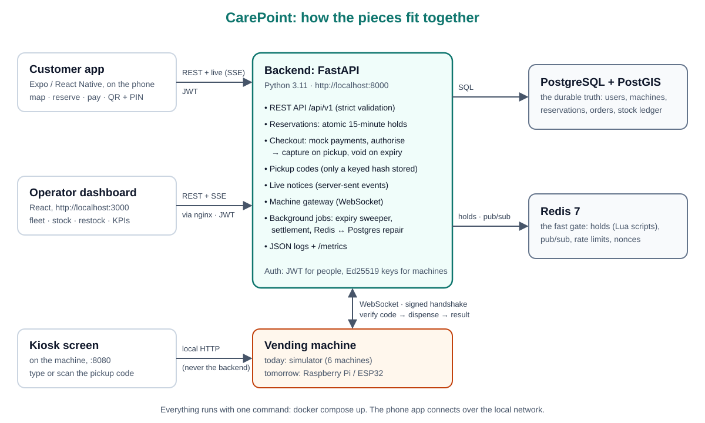

# CarePoint: the one-pager

**Urgent personal-care items, reserved on your phone, picked up from a smart vending machine nearby, any time of day.**

---

## The problem

It's 1 a.m. in a student residence and someone needs pads, condoms, plasters, a pregnancy test or a phone charger. The nearest open pharmacy or shop may be far away, or closed, and asking for some of these items in person is uncomfortable.

Vending machines could help, but today you can't tell from your room whether a machine has what you need, whether it works, or whether the last one will still be there when you arrive.

## The solution

A network of small smart vending machines on campus and in student areas, plus an app.

1. **Find:** a map of nearby machines, with **live stock**.
2. **Reserve:** one tap holds the item for 15 minutes; nobody else can take it.
3. **Pay** in the app. The amount is reserved on the card but **only charged when the item comes out**.
4. **Pick up:** type a 6-digit code or scan a QR code at the machine. The item drops out.
5. **Or not:** if you don't make it in time, the hold ends, the item goes back on sale and **you aren't charged**.

Operators get a live dashboard: every machine's status and stock, reservations as they happen, restocking, products, and KPIs such as pickup rate and uptime.

## How it works

- **The phone app** talks to the **backend** over a normal web API and receives live updates.
- **The backend** keeps the durable records in **PostgreSQL**. It uses **Redis** as an atomic gate, so that when many people try to reserve the last unit at the same moment, exactly one succeeds.
- **The machine** connects to the backend over a secure, always-on connection. It authenticates with its own cryptographic key, reports its stock and condition, and dispenses only on the backend's command, once it has checked the customer's code.
- **The money follows the goods:** authorise at checkout, capture at pickup, void on expiry or cancellation.

## Technology

| Part | Built with |
|---|---|
| Backend | Python 3.11, FastAPI, async SQLAlchemy, PostgreSQL 16 + PostGIS (geo search), Redis 7 |
| Customer app | React Native (Expo), TypeScript, typed directly from the API's own description |
| Operator dashboard | React, TypeScript, live updates |
| Machines | a documented, versioned machine protocol; today six simulated machines with touchscreen kiosks; a Raspberry Pi controller is next ([hardware estimate](hardware-prototype.md)) |
| Running it | Docker Compose: the whole system starts with one command |

**Security by design:**
- passwords, refresh tokens and pickup codes are stored only as hashes;
- machines sign their connections, and each pickup code works only at the one machine holding the item;
- customers only ever see their own reservations;
- a whole-system security review is recorded in the architecture decisions (ADR-031).

## Evidence that it works

- **No overselling under pressure.** 500 simulated customers tapped "reserve" on the same last item at the same instant, 10 times. **Exactly one** won each round, with **0 errors** and a p95 response time of **0.87 s** on a single shared 4-core machine ([benchmarks](../benchmarks.md)).
- **Under steady load:** 200 simulated customers browsing and reserving for a minute, about 158 requests per second, **0 failures**, typical response 26 ms.
- **Tested on every change:**
  - **530 backend tests** against a real database and Redis, including race conditions;
  - **86 app tests**;
  - browser tests of the kiosk and the dashboard;
  - **the whole user story end to end**: reserve, pay, pick up at the machine, and an expired hold being voided.

  A change can't reach the main branch unless all of them pass.
- **A recorded demo** of the full story: [`demo-video.webm`](demo-video.webm).

## Where it stands

**The MVP is complete as software:**
- the customer app;
- the backend;
- the operator dashboard;
- the machine protocol;
- six simulated machines with their touchscreens;
- a demo mode with short holds;
- a script that fills the system with simulated customers for live presentations.

What it doesn't have yet is a physical machine.

## What's next

1. **A physical prototype machine.** Parts list and cost estimate: [`hardware-prototype.md`](hardware-prototype.md), roughly **€612–1,092** in parts. The protocol is already specified, so the backend needs no changes for it.
2. **A campus pilot:** 2–3 machines in student residences, to measure real demand, the pickup rate, and the most-needed items.
3. **After the pilot:**
   - a real payment provider (the payment code is already behind an interface designed for one);
   - push notifications ("your hold ends in 5 minutes");
   - support for more than one operator;
   - richer analytics for restocking;
   - a production cloud deployment.

**What funding would buy:** the prototype machine, and the hardware and stock for a first pilot.
